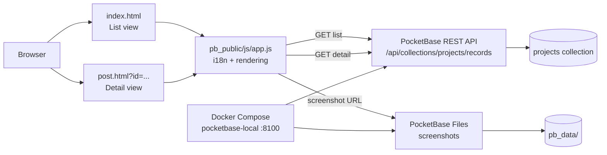

# Pro Index

Public project directory built with a static frontend and PocketBase. The application displays a list of projects, lets users open each record's details, and provides links to the code repository and the project's public URL.

## Features

- Project listing from the PocketBase `projects` collection.
- Detail view through `post.html?id=<project-id>`.
- Descriptions in Spanish, English, and French based on the browser's preferred language.
- Project images served from PocketBase files.
- Links to the repository and public URL.
- Bootstrap 5 and Bootstrap Icons served locally.
- Responsive design for desktop and mobile devices.
- An adapted Bootstrap Blog layout with an editorial introduction, a two-column
  project grid on desktop, and a single column on mobile. Project details use a
  centered reading layout with repository and public links near the title.
- Original (cream editorial) and 16-bit visual styles, selectable from the shared
  header and remembered locally. The blog layout preserves both palettes and
  their typography; no additional theme or CDN dependency is required.

## Requirements

- Docker and Docker Compose.
- Node.js and npm to run ESLint locally.

## Configuration

1. Create the `.env` file from `.env.example`:

   ```bash
   cp .env.example .env
   ```

2. Set your own administrator credentials in `.env`:

   ```env
   PB_ADMIN_EMAIL=admin@localhost.local
   PB_ADMIN_PASSWORD=replace-with-a-generated-secret
   ```

    Do not upload `.env` to the repository. The file is excluded through `.gitignore`.

## Running with Docker

Start PocketBase together with the static frontend:

```bash
docker compose up -d
```

The application will be available at:

- Frontend: <http://localhost:8100>
- PocketBase admin dashboard: <http://localhost:8100/_/>

To stop the container:

```bash
docker compose down
```

Persistent PocketBase data is stored in `pb_data/` and mounted into the container through Docker Compose.

## Development and validation

Install the Node.js dependencies:

```bash
npm install
```

Run ESLint on the frontend:

```bash
npm run lint
```

Apply the available automatic fixes:

```bash
npm run lint:fix
```

You can also check the JavaScript syntax directly:

```bash
node --check pb_public/js/app.js
```

## Project data

The application queries the public PocketBase API through:

```text
/api/collections/projects/records
```

The `projects` collection must provide at least the following fields:

- `id`: record identifier.
- `name`: project name.
- `description_es`, `description_en`, and `description_fr`: translated descriptions.
- `languages`: language or multi-select language field.
- `tech_stack`: multi-select technology field.
- `screenshot`: image filename, if available.
- `collectionId`: collection identifier used to build the file URL.
- `repo`: code repository URL.
- `public`: public project URL.
- `is_public`: boolean visibility flag. Only records with `is_public = true` are exposed on the public website and through public PocketBase list/detail rules.
- `schema`: project-specific Mermaid diagram, displayed in the detail view.

The `languages` and `tech_stack` fields may be received as single values or arrays. The frontend normalizes both cases before rendering the badges.

The `is_public` field is created by the PocketBase migration `20260922120000_add_project_visibility.js` when the `projects` collection already exists. Existing records default to private (`false`), so publish each project intentionally from the PocketBase dashboard.

The `schema` field must contain only the diagram's Mermaid code. For example:

````text
flowchart LR
    browser["Browser"] --> app["Frontend"]
    app --> api["PocketBase API"]
    api --> data[("projects")]
````

The detail view loads Mermaid locally and renders the diagram associated with the record. If a project does not have `schema`, the diagram section is not displayed. For compatibility with existing records, the `diagram` and `architecture` fields are also accepted, although `schema` is the recommended name.

## Contact information

The `contact_info` collection is created automatically by a PocketBase migration. Its initial record contains placeholder values for `email`, `linkedin`, and `github`; replace them in the PocketBase dashboard before publishing. The website reads the first record to populate the contact dropdown on every page. Empty or invalid values are omitted, and the dropdown is hidden when no usable contact method is available. Public users can read contact records, but only administrators can create or edit them. Keep a single record in this collection.

## Visitor tracking

The application records each page load in the PocketBase `visitors` collection. The collection is created automatically by a native PocketBase migration. It stores the visited page path, server-captured IP address, User-Agent, referrer, accepted languages, browser language, platform, screen size, and time zone.

The PocketBase server hook removes visitor records older than seven days once per day. Visitor records can be created publicly by the frontend, but they cannot be listed, viewed, edited, or deleted through the public API. When the site is behind Traefik, the server hook uses the first address in `X-Forwarded-For` (or `X-Real-IP`) as the visitor IP and falls back to the direct connection address. Browser metadata is sent by the frontend. The hook is loaded automatically when PocketBase starts.

The collection itself is created by a native PocketBase migration, so visitor registration does not depend on an administrator login. If an existing installation was started before this migration was added, restart PocketBase once to apply it.

## Local Ollama chat

A bottom-right chat bubble is available on the directory, project and privacy
pages. It opens an accessible modal in the browser's top layer, above page
content. On mobile it fills the visible viewport, including adjustments for the
on-screen keyboard and device safe areas. Public chat text follows the existing
Spanish, English and French translations.

Chat is **disabled by default**. To configure it:

1. Set these additional values in `.env`:

   ```env
   OLLAMA_URL=http://host.docker.internal:11434
   CHAT_PUBLIC_ORIGIN=https://your-public-domain.example
   ```

   `CHAT_PUBLIC_ORIGIN` must exactly match the browser origin (scheme, host and
   port, without a path). Several origins can be separated by commas, for
   example `https://your-public-domain.example,http://localhost:8100`. Opening
   the site from any other address (such as `127.0.0.1` or a LAN IP when only
   `localhost` is listed) makes the chat answer "address not allowed". The
   proxy rejects missing or foreign origins; this is a browser
   cross-origin protection, **not** authentication for public chat.

2. Make Ollama reachable **from the PocketBase container**. `localhost:11434`
   inside that container is not the host's Ollama. Compose adds the
   `host.docker.internal` host-gateway alias for Linux. An Ollama server bound only
   to host loopback may still reject Docker traffic: bind it to an appropriate
   private interface and firewall port 11434 to the required private source.
   Never publish the Ollama port to the Internet. You can instead use a private
   Docker service address in `OLLAMA_URL`. The URL is operator-controlled only;
   it cannot be edited through the public API or chat configuration page.

3. Recreate the service to load environment changes and run migrations:

   ```bash
   docker compose up -d --force-recreate pocketbase
   ```

4. Open `/chat-settings.html` over HTTPS (localhost is allowed for development),
   typing the address directly: the public site deliberately has no link to it.
   Sign in with a PocketBase superuser, select a model from the list of chat
   models installed in Ollama, save the configuration and enable public chat.
   The list is loaded server-side through an administrator-only endpoint, and
   enabling chat with a model that is not installed is rejected. The page also
   configures the assistant's instructions and response token budget (1–512).
   The page reuses the shared header, footer, browser-language translations and
   remembered Original/16-bit visual style, like the rest of the site.

### Chat safeguards and deployment requirements

- Only PocketBase superusers can read or modify settings. Both settings and
  quota collections have all public collection API rules locked. The model,
  endpoint, system instructions, output limit and context size are controlled
  by the server, not by the visitor. The model receives no tools, files,
  credentials or access to private project records. Do not put secrets in the
  system prompt; a language model is not an authorization boundary.
- Administrator tokens stay in JavaScript memory only, never local/session
  storage or cookies. The UI clears its session after five minutes without
  input, on logout and on navigation. This does **not** revoke an already
  issued PocketBase bearer token: configure short superuser token lifetimes.
  Configuration responses are not cached, and the page has a restrictive CSP
  and anti-framing headers.
- **Enable superuser MFA and OTP in PocketBase and configure SMTP before public
  deployment.** The configuration page supports the password + emailed OTP
  MFA flow. A migration enables PocketBase's native rate limiter and adds
  5-attempt/minute rules for superuser password login, OTP requests and OTP
  verification, preserving any existing rules with those exact labels.
- The proxy enforces one generation at a time, 3 requests/minute per connection
  address, 10/minute globally and 100/day globally (UTC). Quotas and the
  concurrency lease are transactional and persisted across server restarts.
  Failed upstream generations also consume quota. The 60-second lease recovers
  after a crash; Ollama requests time out after 45 seconds.
- Quotas deliberately use the **direct connection IP**, not untrusted
  `X-Forwarded-For` headers. Behind a reverse proxy, visitors may share the
  per-connection limit. Forwarded-header spoofing cannot bypass that quota.
  Add trusted edge rate limiting, request-body limits and timeouts to protect
  PocketBase itself. Public quotas limit resource usage, not availability:
  an attacker can exhaust the public daily allowance.
- Input is limited to nine alternating messages, 2,000 characters per user
  message, 8,000 characters total and a 32 KB request body. Only the four most
  recent completed turns are sent. Longer conversations require an explicit
  reset. Context is capped at 4,096 tokens and output at 512 tokens.
- Model text is rendered as plain text, never HTML or executable Markdown.
  The application does not persist conversations or log prompts/responses.
  Connection hashes used for per-minute quotas are cleared by a minute cron
  after expiry; only aggregate counters and configuration remain. Review your
  reverse proxy and Ollama logging separately.
- Terminate HTTPS at your reverse proxy, restrict `/chat-settings.html`, `/_/`,
  the superuser authentication endpoints and `/api/local-chat/settings` to a
  VPN or administrator IPs where possible, and prevent direct access to the
  PocketBase origin that bypasses those restrictions. Do not treat a hidden
  URL or the client-side login form as security. Apply network access controls
  server-side. These application controls do not replace deployment hardening.

### Chat validation

```bash
npm run lint
npm test
PB_TEST_BINARY=/absolute/path/to/pocketbase npm test
```

Tests use Node's built-in runner with no additional dependencies. Unit tests run
normally; the integration test runs only when `PB_TEST_BINARY` is set. It starts
a temporary PocketBase database and a mock Ollama server and checks collection
locks, administrator authorization, configuration validation, origin checks,
request size limits, Ollama requests, concurrency, quotas, upstream errors and
security headers. No existing database is used.
Frontend regression tests also verify that settings and public chat use the
shared translation loader and remembered visual style, and that every settings
label and status message is translated in Spanish, English and French.

## Project structure

```text
.
├── docker-compose.yml       # PocketBase service and persistent volumes
├── .env.example             # Example environment variables
├── eslint.config.mjs        # ESLint configuration
├── package.json              # Development scripts and dependencies
├── pb_hooks/                 # PocketBase server hooks
├── pb_migrations/            # PocketBase schema migrations
├── data/                    # Generated/local PocketBase declarations
├── pb_data/                 # Persistent PocketBase data, not versioned
└── pb_public/
    ├── index.html           # List view
    ├── post.html            # Detail view
    ├── privacy.html         # Privacy information
    ├── css/
    │   ├── bootstrap.min.css
    │   ├── bootstrap-icons.min.css
    │   ├── fonts/           # Bootstrap Icons fonts
    │   └── styles.css       # Custom styles
    └── js/
        ├── app.js           # i18n, API queries, and rendering
        ├── bootstrap.bundle.min.js
        └── mermaid.min.js    # Mermaid diagram rendering
```

## Architecture



### Navigation flow

1. `index.html` loads `app.js` and requests the `projects` records.
2. `app.js` prepares the data, applies the browser language, and generates the cards in a `DocumentFragment`.
3. Each project links to `post.html?id=<id>`.
4. In the detail view, `app.js` requests a single record and renders its complete information.
5. Screenshots are resolved through the PocketBase file path.

## Security notes

- Use a long, unique password for `PB_ADMIN_PASSWORD`.
- Keep `.env` out of version control.
- Review the access rules for the `projects` collection before deploying the project publicly.
- Do not expose the PocketBase admin dashboard without additional protection in a production environment.
